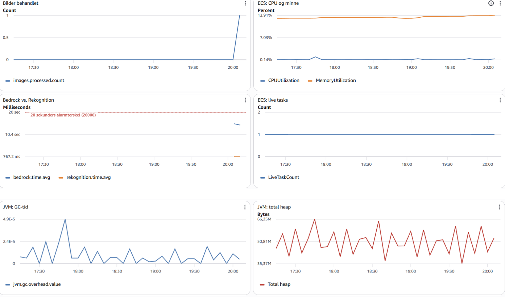
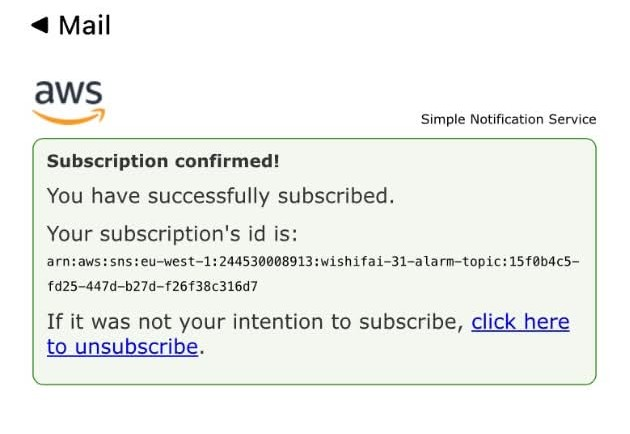

## Oppgave 1a
bygg imaget 
```bash
docker build -t wishifai .
```
kjør container 
```bash
docker run -p 9999:8080 -e AWS_ACCESS_KEY_ID -e AWS_SECRET_ACCESS_KEY -e AWS_REGION=eu-west-1 wishifai
```
Github secrets: 

AWS_ACCESS_KEY_ID

AWS_SECRET_ACCESS_KEY

EMAIL

## Oppgave 1b
Lenke til grønn kjøring: https://github.com/SigurdKaspersen/devops-eksamen/actions/runs/41664792207

Tagging-strategien jeg valgte var full commit-sha, ettersom den garantert er unik, og gjør at imaget man ser etter peker på den respektive commiten i github.

## Oppgave 2a
offentlig URL til tjenesten: https://wi-7ff881939acd4010982f21fd9a0f1a24.ecs.eu-west-1.on.aws/

Jeg ga ikke task role mer tillatelser enn det den trengte fra de ulike servicene, altså ("s3:PutObject", "rekognition:DetectLabels", "bedrock:InvokeModel" og senere "cloudwatch:PutMetricData") fordi minste privilegium er god devops praksis.

## Oppgave 2b
Valgt nøkkel: wishifai/31/terraform.tfstate

## Oppgave 2c
Lenke til grønn kjøring: https://github.com/SigurdKaspersen/devops-eksamen/actions/runs/43042680387

Hvis terraform ikke kjører etter container-builden får ikke ECS startet containeren. ECS skal hente imaget fra ECR, men da må det finnes. Når det kommer til å kjøre terraform parallelt med container-builden kommer det an på hvem som er raskest, skal det fungere må container-builden bli ferdig først. 

## Oppgave 3a
Metrikkene jeg valgte var bedrock.time og rekognition.time som er tiden det tar å kjøre bedrock og rekognition-kallene. Grunderen ville vite hvor tiden ble av, og metrikkene viser at bedrock kallet bruker rundt 15sek på å svare, noe som mest sannsynlig skjer fordi bedrock bruker tid på å generere en respons. Jeg valgte også images.processed som business-metrikk, der bilder som er ferdig behandlet blir registrert, noe som viser hvor mye tjenesten brukes.

## Oppgave 3b
 

 
jeg valgte disse metrikkene fordi jeg mener de sammen gir et helhetligbilde av tjenesten.
Business og Bedrock vs. Rekognition:
(Forklart i 3a).
Applikasjon:
JVM: GC-tid viser hvor mye av tjenestens tid brukes på garbage collecting.
JVM: total heap viser applikasjonens bruk av heap minne.
Infrastruktur:
ECS: CPU og minne viser containerens utnyttelse av minne og cpu 
ECS: live tasks viser antall tasks ECS har kjørende. 

Alarmen er en cloudwatch-alarm som varsler på mail via SNS, der mailen ligger i github-secrets EMAIL . Alarmen overvåker bedrock-kallet, der alarmterskelen ligger på 20 sekunder i 2 minutter på rad, den ble satt på 20 sekunder ettersom gjennomsnittlig svartid er på 14-15 sekunder og det er mest sannsynlig der tjenestens treghet ligger.



## Oppgave 4 
AI og DevOps-praksiser

En LLM eller «large language model» er ofte brukt i digitale løsninger i dag. Den kan bli brukt til alt fra å analysere, tolke og oversette, til å produsere og oppsummere tekst. Applikasjoner kan til og med være LLM-baserte, der store deler av hovedfunksjonaliteten til applikasjonen er AI-drevet. Responsene man kan få fra en LLM kan både være gode og fornuftige, men også dårlige og enkelte ganger støtende. Dette er ting man må ta hensyn til i moderne DevOps-praksiser.
Når det kommer til risiko og ansvar for DevOps-praksiser med et LLM-element, kan man gå proporsjonalt til verks. For en tjeneste som Wishifai trenger man neppe omfattende tester før applikasjonen går til produksjon. Dette er fordi det er lav risiko. Wishifai gjør ikke mer enn å foreslå gaveønsker basert på et opplastet bilde. Konsekvensen av et upassende gaveønske er betydelig mindre enn om applikasjonen hadde fungert som et verktøy for offentlig helsevesen, der LLM-en opererte med helsedata og skulle symptomkartlegge pasienter. I så fall måtte man hatt grundigere og flere tester med menneskelig godkjenning. For Wishifai hadde nok en test der gaveønskene gikk gjennom en ordliste for «flaggede» ord vært nok. Hvem har egentlig ansvaret? Om en bedrift bruker en LLM til sin tjeneste, ligger ansvaret hos bedriften. Det er derfor viktig med god DevOps-praksis med testing og kontroll som står i forhold til risikovurderingen av det tjenesten gjør.
Videre ser vi at overvåkingen av Wishifai er begrenset når det gjelder upassende gaveønsker. Man har helse- og hastighetsmåling av tjenesten, der alarmen går ved Bedrock-latency, men ingen målinger for ugunstige svar fra applikasjonen. Ved å ha menneske-i-loopen kan man potensielt ta stikkprøver av tjenesten. Som nevnt tidligere måtte en helseapplikasjon ha operert på et høyere sikkerhetsnivå, ettersom konsekvensene kunne vært fatale. Her burde helsepersonell sjekket LLM-svarene hver gang tjenesten ble brukt.
Det er derfor essensielt at testing og overvåking tilpasses de potensielle konsekvensene tjenesten kan forårsake. Det samme gjelder kontinuerlig leveranse. Er risikoen høy og tjenesten må være driftsklar, kan det være lurt med menneskelig godkjenning før deployment.
